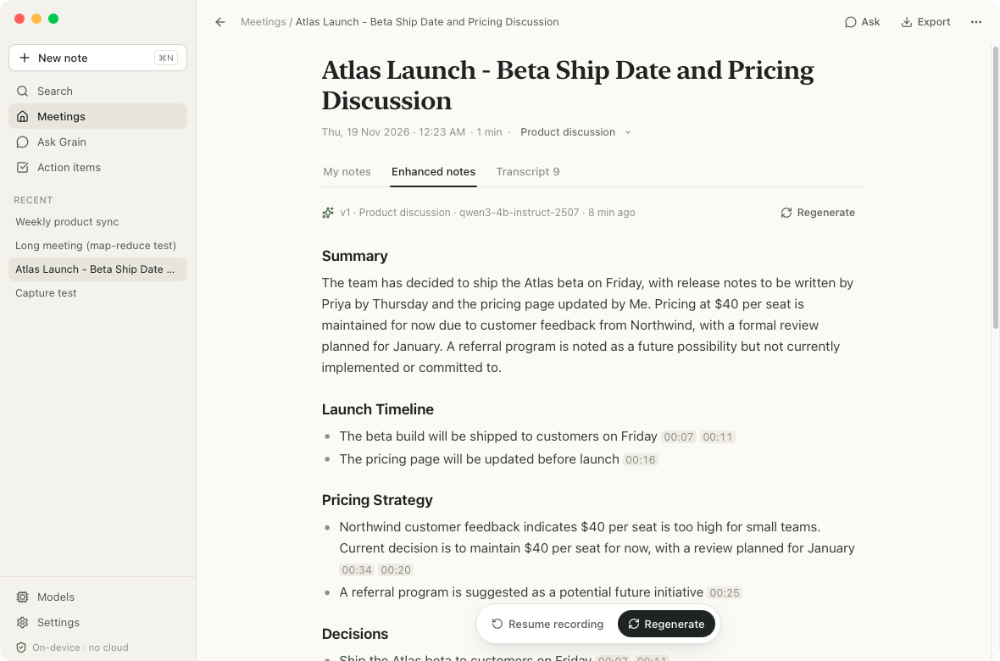
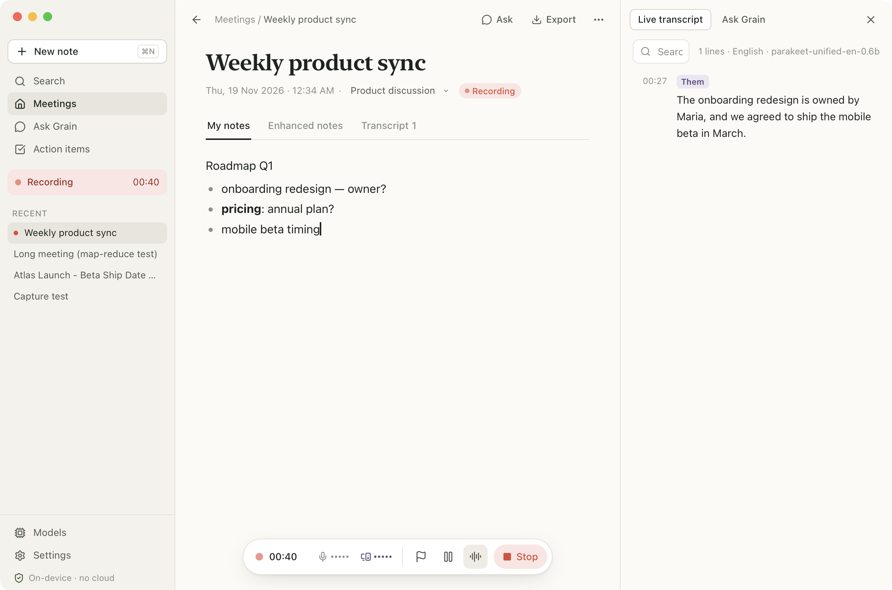
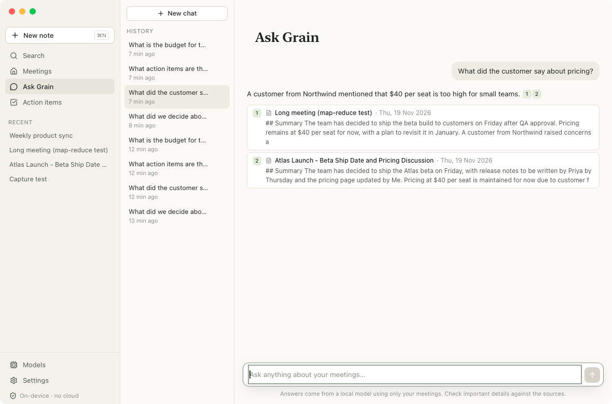
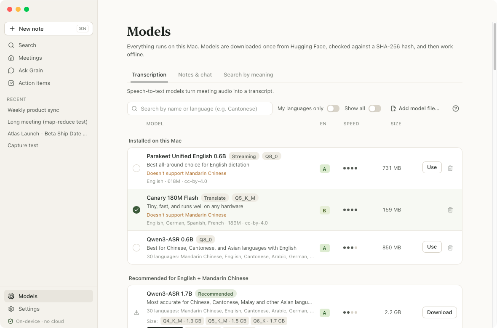
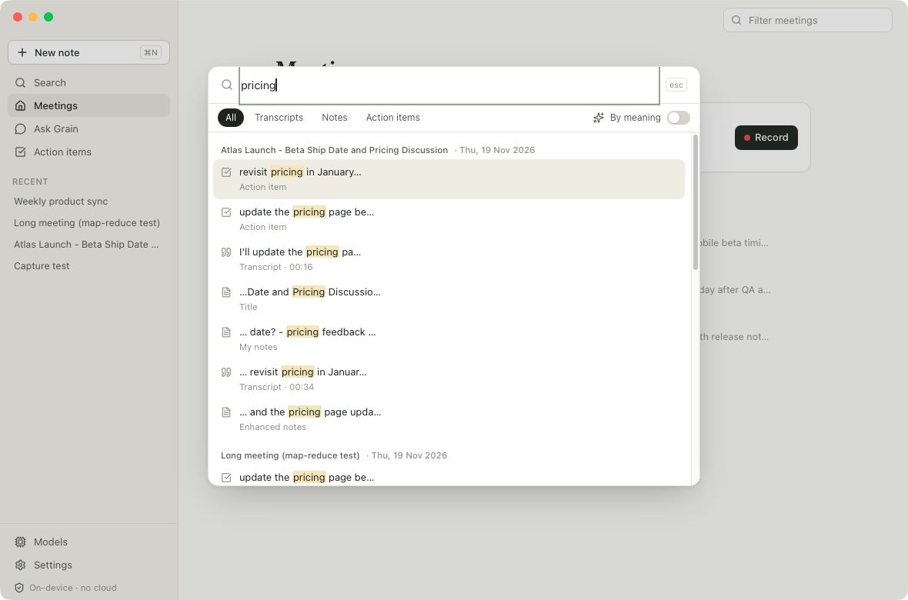

# Grain

**A private AI notepad for meetings that runs entirely on your Mac.**

Grain records your microphone and your computer's audio (no meeting bot), transcribes on-device with open-weight speech models, and turns your rough notes plus the transcript into structured meeting notes with a local LLM. Decisions and action items link back to the moment they were said. You can search every meeting and ask questions across them. There is no account and no cloud, and after the one-time model downloads Grain works with the internet switched off.



| | |
|---|---|
|  |  |
|  |  |

## What works today (verified, see [docs/TEST_PLAN.md](docs/TEST_PLAN.md))

- **Bot-free capture.** Microphone via AVFoundation and system audio via ScreenCaptureKit, in a native Swift helper. Each source goes to its own crash-safe track. Pause and resume, mic switching, device-loss fallback, and recovery of interrupted recordings.
- **Local transcription.** [transcribe.cpp](https://github.com/handy-computer/transcribe.cpp) on Metal, with Handy's catalogue of 70+ GGUF models (Parakeet, Qwen3-ASR, Whisper, Canary and more). Live (chunked at pauses) or after the meeting. You can re-transcribe with a different model and correct transcript lines (the original text is kept). Mic audio is labelled "Me", system audio "Them".
- **Enhanced notes.** A local LLM ([llama.cpp](https://github.com/ggml-org/llama.cpp) `llama-server`, Metal) writes the summary, topics, decisions, action items with owners and deadlines, open questions and follow-ups. Output is JSON-schema constrained. A verification pass removes owners and deadlines that nobody said and flags claims it can't find in the transcript. Long meetings use map-reduce. There are seven built-in templates plus your own, and previous versions are kept.
- **Your notes stay yours.** "My notes" is never overwritten. Enhanced notes are a separate, editable, versioned document.
- **Search and Ask Grain.** SQLite FTS5 search (trigram, works for CJK) and optional semantic search with a local embedding model. Ask Grain answers with numbered citations to meetings and transcript moments, and says when it can't find something.
- **Model manager.** Download any of Handy's models, as Handy does: Parakeet V2/V3/Unified/Ultra, Whisper tiny–large-v3-turbo, Qwen3-ASR, Canary, Cohere Transcribe, SenseVoice, Breeze, GigaAM and more, with 70+ behind "Show all". You can pick the quantisation (Q4_K_M up to F16) to trade size for accuracy. Picking a model downloads it and switches to it when it's ready, from the Models page or the Settings dropdown. You can add your own `.gguf` files. **Models already on this Mac are found and reused, never downloaded twice.** At launch Grain picks them up by itself (no click needed):  Handy's models (Hugging Face cache), Ollama, LM Studio, llama.cpp, Jan, GPT4All and `/Users/Shared`. Each is verified with SHA-256 and shared via an APFS clone, so it takes no extra disk space and the original is left untouched. Per-language accuracy grades come from published FLEURS results, alongside speed, size, licence and RAM warnings. Downloads are resumable, cancellable and SHA-256 verified.
- **Export.** Markdown, plain text, JSON, PDF (via the print dialog) and WAV.
- **Privacy.** No telemetry, no account. The LLM runtime runs with `--offline` on 127.0.0.1 with a random API key. The full workflow was verified offline in a macOS network sandbox.

## Install (macOS 14+, Apple Silicon)

The build produces `src-tauri/target/release/bundle/macos/Grain.app` and a `.dmg` in `bundle/dmg/`. The app is **not code-signed or notarised** (that needs an Apple Developer ID), so the first launch needs a right-click, then **Open**. You can also clear the quarantine flag:

```bash
xattr -dr com.apple.quarantine /Applications/Grain.app
```

Then run through onboarding: choose your languages, download the recommended models, allow Microphone and "Screen & System Audio Recording", and run the audio test.

## Build from source

Requirements: macOS 14+ on Apple Silicon, Xcode Command Line Tools, Rust (stable), Node 20+, CMake.

```bash
npm install
npm run sidecars          # builds the Swift capture helper and a static Metal llama-server
npx tauri dev             # run in development
npx tauri build           # release .app + .dmg
```

`scripts/build-llama-server.sh` pins the llama.cpp tag (`LLAMA_CPP_TAG`, default `v1.0.0`) and builds it without its web UI or networking libraries.

## Test

```bash
npm run typecheck && npm run lint && npm test          # frontend
(cd src-tauri && cargo test --lib && cargo clippy)      # backend unit tests
# Real end-to-end run: downloads models, records system audio, transcribes, writes notes, asks questions, exports
(cd src-tauri && cargo build --release --example e2e)
src-tauri/target/release/examples/e2e download ~/Library/Caches/grain-e2e
scripts/offline.sh src-tauri/target/release/examples/e2e run ~/Library/Caches/grain-e2e docs/test-results/e2e-offline.json
```

`scripts/offline.sh` runs a command in a macOS sandbox that blocks all network access except loopback.

GUI end-to-end test of every feature through the real UI (release app, a fresh data folder, your data untouched): `npx tauri build && scripts/e2e-gui.sh`. The result is in `docs/test-results/gui-e2e.json`.

## Documentation

| Doc | |
|---|---|
| [PRODUCT_RESEARCH](docs/PRODUCT_RESEARCH.md) | Granola and Handy research, observed vs inferred |
| [UI_REFERENCE_AUDIT](docs/UI_REFERENCE_AUDIT.md) | Mobbin research and the visual audit rounds |
| [DESIGN_SYSTEM](docs/DESIGN_SYSTEM.md) | Tokens, type, components, motion |
| [SCREEN_INVENTORY](docs/SCREEN_INVENTORY.md) | Every screen and its states |
| [ARCHITECTURE](docs/ARCHITECTURE.md) | Modules, data flow, schema, trade-offs |
| [IMPLEMENTATION_PLAN](docs/IMPLEMENTATION_PLAN.md) | Phases and status |
| [MODEL_COMPATIBILITY](docs/MODEL_COMPATIBILITY.md) | Supported, implemented and tested models |
| [PRIVACY](docs/PRIVACY.md) | Network behaviour, storage, retention, deletion |
| [TEST_PLAN](docs/TEST_PLAN.md) | Tests and measured results |
| [KNOWN_LIMITATIONS](docs/KNOWN_LIMITATIONS.md) | What doesn't work yet |

## Credits and licences

Grain is MIT-licensed. It builds on transcribe.cpp (MIT), Handy's model catalogue (MIT), llama.cpp/ggml (MIT), Tauri (MIT/Apache-2.0) and TipTap (MIT). Each model has its own licence (Apache-2.0, CC-BY-4.0, and some CC-BY-NC), shown in the model manager. Grain is an independent project, not affiliated with Granola, Handy, or the meeting recorder at grain.com (see the name note in [KNOWN_LIMITATIONS](docs/KNOWN_LIMITATIONS.md)).
