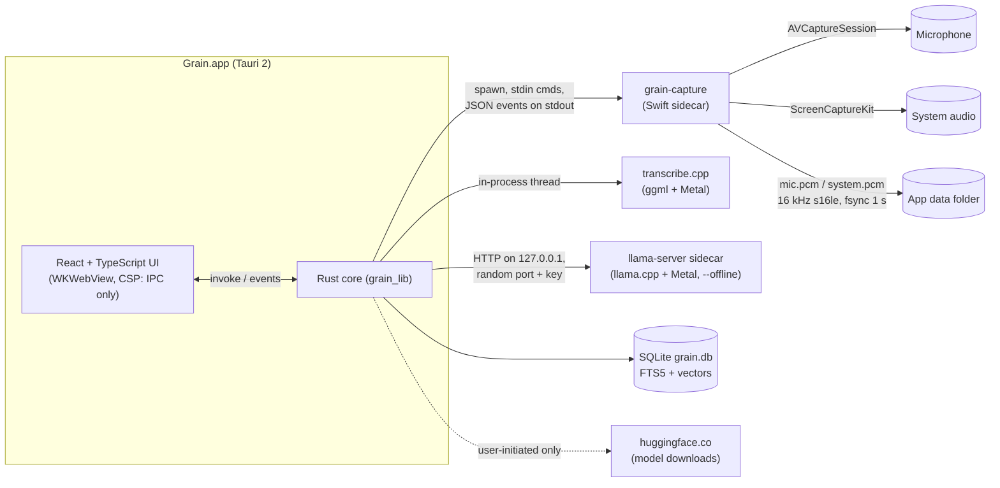
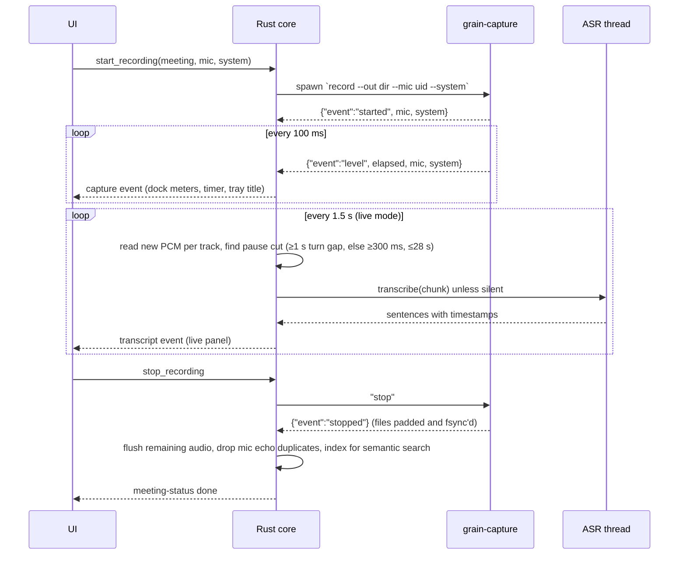
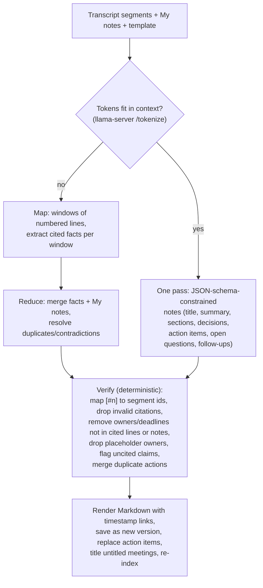

# Architecture

## System overview



| # | Module | Location | Responsibility |
|---|---|---|---|
| 1 | Desktop shell | `src-tauri/src/lib.rs` | Window, tray/menu bar (recording timer, Stop), keep recording when the window closes, command registry |
| 2 | Audio capture | `native/macos/grain-capture/main.swift`, `capture.rs` | Mic + system capture, pause/resume, device switching, permissions, start/stop/finalise, crash recovery |
| 3 | Audio processing | `audio.rs` | PCM I/O, pause-based chunking, silence gating, echo de-duplication, WAV writing |
| 4 | Transcription | `asr.rs` | Engine thread owning the model; live chunked loop; post-meeting (re)transcription; language-hint policy; sentence segmentation |
| 5 | Model registry and downloads | `models.rs`, `catalog/*.json` | Bundled catalogue, recommendations, resumable verified downloads, deletion, reconciling files on disk |
| 6 | LLM inference | `llm.rs` | llama-server lifecycle (start on demand, idle stop), chat (schema-constrained), streaming, tokenise, embeddings |
| 7 | Note generation | `notes.rs` | Prompting, single pass / map-reduce, verification, Markdown rendering, versioning |
| 8 | Local database | `db.rs` | Schema, migrations, queries, FTS index maintenance, vector storage |
| 9 | Search and retrieval | `db.rs` (search), `chat.rs` | FTS5 + semantic + RRF fusion, date filters, Ask Grain RAG, semantic indexing |
| 10 | Frontend | `src/` | Screens, design system, typed API (`src/lib/api.ts`), app state (`src/lib/store.tsx`) |

Swapping a model is a settings change (`asrModel`, `llmModel`, `embedModel`). The UI only sees catalogue metadata, so a new model needs a catalogue entry, not UI work.

## Audio processing flow



- **Two tracks, one timeline.** Each source is converted to 16 kHz mono Int16 by `AVAudioConverter`. When a source delivers nothing (ScreenCaptureKit sends no buffers during silence, and a device switch leaves a gap), the writer pads with zeros against a shared wall clock minus paused time, so `mic.pcm[i]` and `system.pcm[i]` are the same instant. Drift is bounded by the 250 ms padding threshold.
- **Crash safety.** Raw headerless PCM is appended and fsync'd every second, so a crash loses at most about a second, and a truncated file is still valid. If Grain dies, the helper sees stdin close or its parent change, stops, and flushes. On next launch, meetings left `recording` are marked `interrupted` and their audio can be transcribed.
- **Speaker labels.** Mic = "Me", system = "Them" (or "Room" for mic-only in-person meetings). No names are assigned automatically.
- **Echo.** On speakers, the mic hears the remote side. Mic segments that repeat an overlapping system segment (token overlap ≥ 0.6 within ±2 s) are dropped.
- **Concurrency.** Capture runs in its own process and inference on separate threads/processes, so heavy transcription or notes generation can't stall capture. One ASR thread processes jobs in order.

## Local inference flow (enhanced notes)



Prompts require explicit commitments versus suggestions, an empty owner or deadline when unknown, citations for every decision and action, the meeting's language, and coverage of every point in the user's notes. Thinking is disabled (`--reasoning off`, `enable_thinking:false`) and any stray `<think>` blocks are stripped.

**Ask Grain:** keywords (FTS5) plus a semantic query (embedding model, if installed), fused with reciprocal rank fusion, plus date filters, plus open action items for task questions. Transcript hits are expanded with neighbouring lines, and up to 12 numbered sources are fitted to the context. The answer is streamed. Only the sources it cites are attached; with no sources the model isn't called at all.

## Database schema (v1, `PRAGMA user_version` migrations)

```mermaid
erDiagram
  meetings ||--o{ recordings : has
  meetings ||--o{ segments : has
  meetings ||--o{ notes : has
  meetings ||--o{ action_items : has
  meetings ||--o{ marks : has
  meetings ||--o{ embeddings : has
  meetings ||--o{ chat_threads : "scoped (optional)"
  chat_threads ||--o{ chat_messages : has
  meetings { text id PK; text title; int created_at; int started_at; int ended_at; int duration_ms; text status; text template_id; text folder; text language; json metadata }
  recordings { text id PK; text meeting_id FK; text source "mic|system"; text path; int sample_rate; int duration_ms; text status }
  segments { int id PK; text meeting_id FK; text source; text speaker; int start_ms; int end_ms; text text; text original_text; text language; text model_id; text status; bool edited }
  notes { int id PK; text meeting_id FK; text kind "manual|enhanced"; int version; text content "markdown"; json structured; text model_id; text template_id }
  action_items { int id PK; text meeting_id FK; text description; text owner; text deadline; text kind "commitment|suggestion"; text status; bool verified; json evidence "segment ids" }
  marks { int id PK; text meeting_id FK; int at_ms; text label }
  models { text id PK; text role; text name; text family; text version "HF revision"; text path; text quant; int size; text sha256; text status }
  settings { text key PK; json value }
  templates { text id PK; text name; text instructions; bool builtin }
  embeddings { int id PK; text meeting_id FK; text kind; int ref_id; int start_ms; text text; blob vector "f32 LE"; text model_id }
```

There is also `search_index`, an FTS5 virtual table (trigram tokenizer) over titles, notes, segments and action items. It's maintained by the application on every write and removed with the meeting. All foreign keys use `ON DELETE CASCADE`, with `PRAGMA foreign_keys=ON` and WAL mode.

## Model download design

0. **Already on this Mac?** At startup (and when Models opens), `local.rs` scans, read-only and without hashing: the Hugging Face cache (where **Handy** keeps its models; blobs are named by their SHA-256, so they match exactly), Ollama blobs (`sha256-<hash>`), LM Studio, the llama.cpp cache, Jan, GPT4All, `/Users/Shared` and folders the user adds (file name + exact size). A match for the requested quant is used instead of downloading: the SHA-256 is verified, then the file is **APFS-cloned** into Grain's folder (instant, no extra space, independent of the original), or on another volume used in place. If verification fails, Grain downloads as normal. Non-catalogue GGUFs (e.g. LM Studio's LLMs) are classified from their GGUF header (`general.architecture`) and offered as "Other models found on this Mac".
1. The catalogue entry gives repo, pinned revision, filename, size and SHA-256. The URL is `https://huggingface.co/{repo}/resolve/{revision}/{filename}`.
2. If the file already exists with the right size, it's verified and registered without downloading again.
3. Free disk is checked against the remaining bytes plus 256 MB; if short, the download is refused with both sizes.
4. Writes go to `{file}.part`. On resume, the existing part is hashed and a `Range: bytes=n-` request is sent; if the server answers 200 instead of 206, the download restarts.
5. The file is streamed with an incremental SHA-256, progress events go out every 250 ms, and a cancel flag is checked per chunk (the `.part` is kept for resume).
6. Hash mismatch → the part is deleted and an error shown. Match → fsync, atomic rename, `models` row = `ready`. The first model of a role becomes active.

Storage layout: `models/{asr|llm|embed}/{id}/{file}.gguf`, `recordings/{meeting}/{mic,system}.pcm`, `grain.db`. Directories are created `0700`.

## Key trade-offs

| Decision | Alternatives | Why |
|---|---|---|
| transcribe.cpp for every ASR model | whisper.cpp, ONNX Runtime | One engine and format for Parakeet, Qwen3-ASR, Whisper and Canary; Metal; MIT; Rust bindings; used by Handy |
| llama-server as a separate process | llama-cpp-2 crate in-process | Both libraries vendor ggml (duplicate symbols). A process also frees all model memory on exit and isolates crashes. Bound to loopback with a key, run offline |
| Swift helper process for capture | Rust `screencapturekit`/`cpal` crates | First-class Apple APIs; isolation means audio survives app crashes; clear seam for a Windows (WASAPI) helper later |
| Raw PCM tracks | WAV/Opus chunks | Crash-proof with no header to fix up, trivially seekable for live chunking; WAV on export. Cost: ~115 MB per hour per track |
| Energy-based pause chunking | Silero VAD | No extra model; good on clean meeting audio. VAD is the upgrade path for noisy rooms |
| Chunked "live" transcription | Native streaming | Works for every family. Streaming-capable models (Parakeet Unified, Nemotron) could use `Session::stream` later |
| Trigram FTS5 + LIKE fallback | unicode61 | Substring search works for CJK; terms under 3 characters fall back to a scan |
| Brute-force cosine over SQLite blobs | sqlite-vec, HNSW | Zero dependencies; fine for thousands of chunks |
| In-process ASR thread | Handy's worker process | Simpler. A native abort would close the window, but capture continues in its own process and audio is recovered on relaunch |
