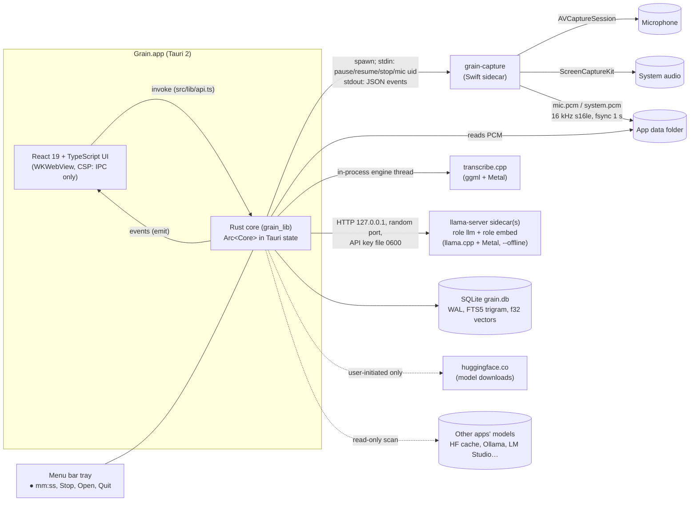
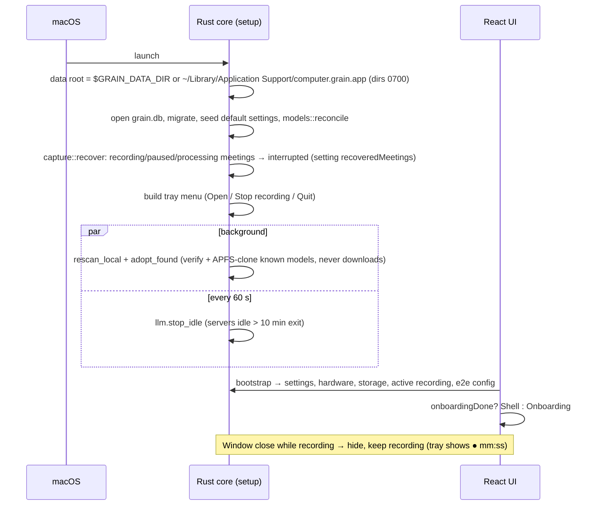
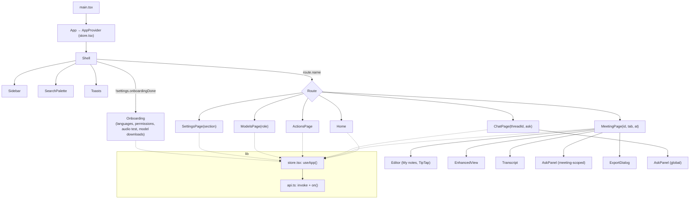
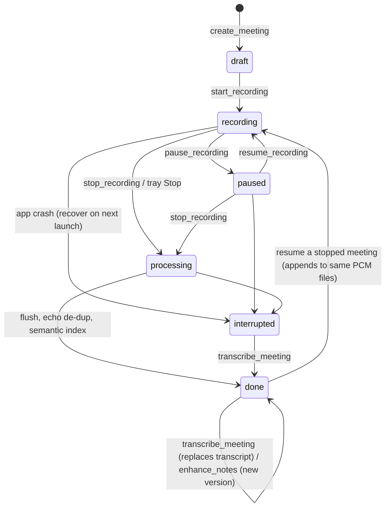
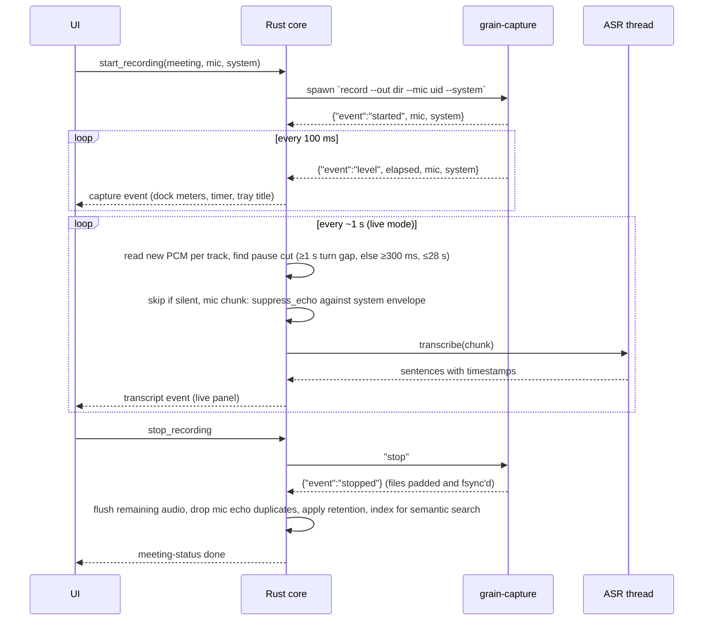
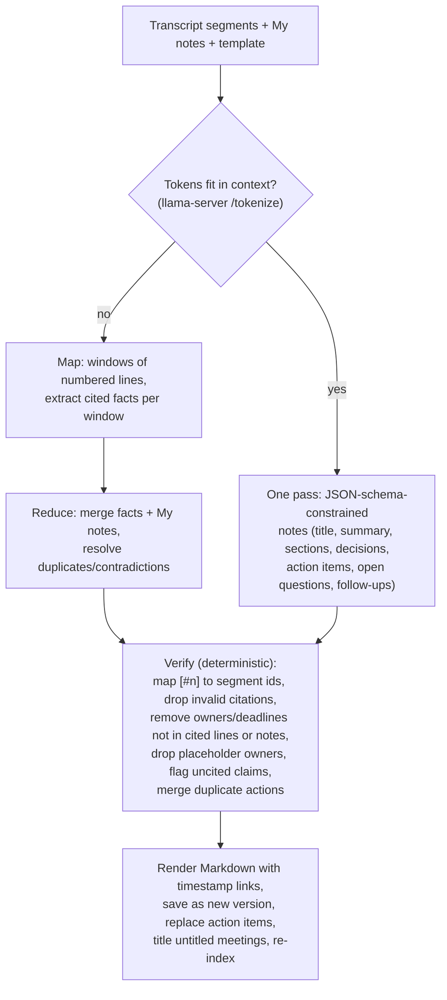
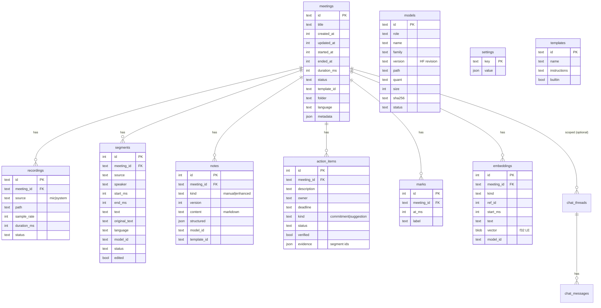
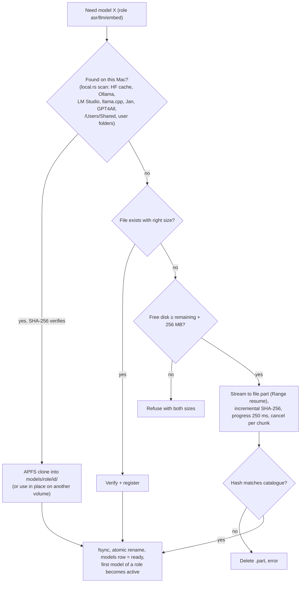
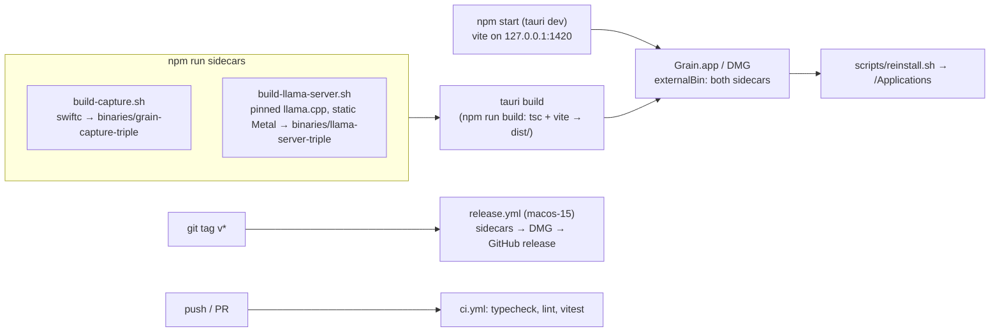

# Architecture

Reference map of Grain for humans and AI agents. Read this before changing anything across module boundaries. When code and this doc disagree, the code wins; fix the doc in the same change.

Grain is a private, on-device meeting notepad for macOS (Apple Silicon, macOS 14+). It records mic + system audio, transcribes locally, writes cited meeting notes with a local LLM, and answers questions over past meetings. Nothing leaves the Mac except model downloads the user starts.

## 1. System overview

Three OS processes at most during a meeting: the app (UI + Rust core + ASR thread), `grain-capture`, and up to two `llama-server` instances (notes/chat LLM and embeddings). Capture is isolated so app crashes or heavy inference never lose audio.

## 2. Repository map

| Path | What lives there |
|---|---|
| `src/main.tsx`, `src/App.tsx` | React entry, `Shell` (route switch, global shortcuts ⌘N ⌘K ⌘, ⌘[ ⌘J, theme attribute, onboarding gate) |
| `src/lib/api.ts` | **The only IPC surface.** Typed wrappers for every Tauri command + `on(event, cb)` listener helper + shared TS types (`Meeting`, `Segment`, `Note`, `ActionItem`, `CatalogModel`, …) |
| `src/lib/store.tsx` | `AppProvider` / `useApp()`: routing (`Route`), settings, meetings list, recording state, downloads, toasts, LLM status; subscribes to global events |
| `src/lib/format.ts`, `dialogs.ts` | Formatting (`fmtTs`, `fmtBytes`, `fmtDuration`), native save/confirm dialogs |
| `src/pages/` | `Home`, `MeetingPage` (notes / enhanced / transcript tabs + recording dock), `ChatPage`, `ActionsPage`, `ModelsPage`, `SettingsPage`, `Onboarding` |
| `src/components/` | `ui.tsx` (design-system primitives), `Editor` (TipTap + markdown), `EnhancedView`, `Transcript`, `AskPanel`, `SearchPalette`, `Sidebar`, `ExportDialog`, `Toasts` |
| `src/e2e/runner.ts` | In-app GUI end-to-end runner, active only when `GRAIN_E2E=1` |
| `src/styles.css`, `src/components.css`, `design/` | Design system (tokens, component CSS, assets). See `docs/DESIGN_SYSTEM.md` and root `CLAUDE.md` |
| `src-tauri/src/lib.rs` | `Core`, `Paths`, every `#[tauri::command]`, tray, window-close behaviour, startup tasks |
| `src-tauri/src/capture.rs` | Spawns/talks to `grain-capture`, live session, finalise, crash recovery, audio test, retention |
| `src-tauri/src/audio.rs` | PCM I/O, silence gating, pause-based chunk cuts, pre-ASR echo suppression, post-ASR echo de-dup, WAV |
| `src-tauri/src/asr.rs` | ASR engine thread, live loop, post-meeting (re)transcription, language-hint policy, sentence splitting |
| `src-tauri/src/llm.rs` | `LlmManager`: llama-server lifecycle per role, chat (JSON-schema), streaming, tokenize, embeddings, idle stop |
| `src-tauri/src/notes.rs` | Enhanced notes: prompts, single-pass / map-reduce, deterministic verification, Markdown render |
| `src-tauri/src/chat.rs` | Ask Grain RAG: keyword + semantic retrieval, RRF, date filters, sources, semantic indexing |
| `src-tauri/src/db.rs` | SQLite schema, migrations, all queries, FTS maintenance, vector storage, search |
| `src-tauri/src/models.rs`, `catalog/*.json` | Bundled model catalogue, recommendations, verified resumable downloads, import, reconcile |
| `src-tauri/src/local.rs` | Read-only scan for models other apps already downloaded; GGUF header classification |
| `src-tauri/src/export.rs` | Markdown / text / JSON / WAV export and preview |
| `src-tauri/src/hardware.rs` | RAM / chip / disk detection for recommendations |
| `src-tauri/examples/` | Dev CLIs: `e2e.rs` (headless pipeline), `scan.rs`, `words.rs` |
| `native/macos/grain-capture/main.swift` | Capture helper: subcommands `record`, `devices`, `permissions`, `request-mic`, `request-screen` |
| `src-tauri/binaries/` | Built sidecars `grain-capture-<triple>`, `llama-server-<triple>` (from `scripts/`) |
| `scripts/` | `build-capture.sh`, `build-llama-server.sh` (pinned llama.cpp commit), `reinstall.sh`, `e2e-gui.sh`, `offline.sh`, worktree helpers, site screenshots |
| `.github/workflows/` | `ci.yml` (typecheck, lint, vitest), `release.yml` (tag `v*` → sidecars → DMG → GitHub release) |

## 3. Module responsibilities (backend)

| # | Module | Location | Responsibility |
|---|---|---|---|
| 1 | Desktop shell | `lib.rs` | Window, tray/menu bar (recording timer, Stop), keep recording when the window closes, command registry, startup tasks |
| 2 | Audio capture | `main.swift`, `capture.rs` | Mic + system capture, pause/resume, device switching, permissions, start/stop/finalise, crash recovery |
| 3 | Audio processing | `audio.rs` | PCM I/O, pause-based chunking, silence gating, echo suppression + de-duplication, WAV writing |
| 4 | Transcription | `asr.rs` | Engine thread owning the model; live chunked loop; post-meeting (re)transcription; language-hint policy; sentence segmentation |
| 5 | Model registry and downloads | `models.rs`, `local.rs`, `catalog/*.json` | Catalogue, recommendations, resumable verified downloads, adopting models found on this Mac, deletion, reconcile |
| 6 | LLM inference | `llm.rs` | llama-server lifecycle (start on demand, idle stop), chat (schema-constrained), streaming, tokenise, embeddings |
| 7 | Note generation | `notes.rs` | Prompting, single pass / map-reduce, verification, Markdown rendering, versioning |
| 8 | Local database | `db.rs` | Schema, migrations, queries, FTS index maintenance, vector storage |
| 9 | Search and retrieval | `db.rs` (search), `chat.rs` | FTS5 + semantic + RRF fusion, date filters, Ask Grain RAG, semantic indexing |
| 10 | Frontend | `src/` | Screens, design system, typed API (`api.ts`), app state (`store.tsx`) |

Swapping a model is a settings change (`asrModel`, `llmModel`, `embedModel`). The UI only sees catalogue metadata, so a new model needs a catalogue entry, not UI work.

`Core` (in `lib.rs`) is the single shared object: `db`, `paths`, `emit` (event sink), `asr` (`AsrEngine`), `llm` (`LlmManager`), `downloads`, `capture` (`Mutex<Option<CaptureSession>>`, at most one recording), `on_recording` (tray updater), `found` (last local-model scan). Every command takes `State<Arc<Core>>`. `Emit` is an `Arc<dyn Fn(&str, Value)>` so the core also runs headless (tests, `examples/e2e.rs`).

## 4. App lifecycle

Default settings seeded on first run: `transcriptionMode=live`, `captureSystem=true`, `languages=["en"]`, `asrLanguage=auto`, `keepAudio=true`, `defaultTemplate=general`.

## 5. Frontend architecture

- **Routing** is in-memory state (`Route` union in `store.tsx`), not URLs: `home | meeting{id,tab?,at?} | chat{threadId?,ask?} | actions | models{role?} | settings{section?}`. `navigate()` / `back()` keep a history stack.
- **State**: one React context (`useApp`). No Redux/Zustand. Pages fetch their own detail data via `api.*` and reload on relevant events.
- **Settings** are a flat key/value map persisted in SQLite through `set_setting`; the store mirrors them and applies `settings-changed` events from the backend. UI-only keys (`theme`, `sidebarCollapsed`, `sidebarWidth`, `onboardingDone`, `micDevice`) live in the same table.
- **Design system** rules are mandatory (root `CLAUDE.md`, enforced by `src/design.test.ts`).

## 6. IPC contract

All calls go through `src/lib/api.ts` → `invoke(command, args)`. Commands return `Result<T, String>`; errors surface as toasts. Adding a command means: `#[tauri::command]` fn in `lib.rs` → add to `generate_handler!` → typed wrapper in `api.ts`.

| Area | Commands |
|---|---|
| Boot / settings | `bootstrap`, `set_setting`, `storage`, `reveal_data_folder`, `open_privacy_settings`, `delete_all_data` |
| Meetings | `list_meetings`, `create_meeting`, `meeting_detail`, `update_meeting`, `delete_meeting`, `delete_audio` |
| Notes / transcript | `save_manual_note`, `save_enhanced_note`, `enhanced_version`, `update_segment`, `add_mark` |
| Action items | `list_action_items`, `set_action_status` |
| Capture | `capture_permissions`, `request_permission`, `list_devices`, `start_recording`, `pause_recording`, `resume_recording`, `stop_recording`, `switch_mic`, `audio_test` |
| AI | `transcribe_meeting`, `warm_models`, `enhance_notes`, `ask`, `list_threads`, `thread_messages`, `delete_thread`, `search`, `reindex_semantic` |
| Models | `list_catalog`, `recommend`, `download_model`, `cancel_download`, `delete_model`, `import_model`, `rescan_local_models`, `use_found_model` |
| Templates | `list_templates`, `save_template`, `delete_template` |
| Export | `export_meeting`, `export_preview`, `print_window` |
| E2E only (`GRAIN_E2E=1`) | `e2e_say`, `e2e_report`, `e2e_file`, `e2e_exit` |

Backend → UI events (`emit` / `on`):

| Event | Emitted by | Payload / meaning | Listened in |
|---|---|---|---|
| `capture` | `capture.rs` | Relayed helper events: `started`, `level` (every 100 ms: elapsed, mic, system), `paused`, `resumed`, `device_changed`, `device_lost`, `error`, `stopped` | `store.tsx`, `MeetingPage` |
| `transcript` | `asr.rs` | `{meetingId, segments}` new live segments | `MeetingPage` |
| `meeting-status` | `capture.rs` | `{meetingId, status: processing/done/interrupted}` | `store.tsx`, `MeetingPage` |
| `transcription-status` | `asr.rs`, `lib.rs` | `{meetingId, state: running(progress)/done/error/unavailable}` | `store.tsx`, `MeetingPage` |
| `enhance-status` | `notes.rs`, `lib.rs` | `{meetingId, stage, progress}` or `stage: error` | `EnhancedView` |
| `chat-token` | `chat.rs` | `{threadId, token}` streamed answer | `AskPanel` |
| `llm-status` | `llm.rs` | `{state: loading/ready, role, model}` or `{warning}` (low RAM) | `store.tsx` |
| `model-download` | `models.rs` | `{id, state: downloading/verifying/ready/cancelled/failed, downloaded, total, bytesPerSec}` every 250 ms | `store.tsx` |
| `local-models` | `lib.rs` | Scan count or `{adopted}` | `store.tsx` (refresh catalogue) |
| `settings-changed` | `lib.rs` | Partial settings the backend changed (e.g. active model) | `store.tsx` |
| `audio-test` | `capture.rs` | Live levels during the test | `SettingsPage`, `Onboarding` |

## 7. Meeting lifecycle

## 8. Audio processing flow

- **Two tracks, one timeline.** Each source is converted to 16 kHz mono Int16 by `AVAudioConverter`. When a source delivers nothing (ScreenCaptureKit sends no buffers during silence, and a device switch leaves a gap), the writer pads with zeros against a shared wall clock minus paused time, so `mic.pcm[i]` and `system.pcm[i]` are the same instant. Drift is bounded by the 250 ms padding threshold.
- **Crash safety.** Raw headerless PCM is appended and fsync'd every second, so a crash loses at most about a second, and a truncated file is still valid. If Grain dies, the helper sees stdin close or its parent change, stops, and flushes. On next launch, meetings left `recording`/`paused`/`processing` are marked `interrupted` and their audio can be transcribed.
- **Speaker labels.** Mic = "Me", system = "Them" (or "Room" for mic-only in-person meetings). No names are assigned automatically.
- **Echo, two stages.** (1) Before ASR, `audio::suppress_echo` silences parts of a mic chunk whose loudness envelope tracks the system track (speaker echo sits ~15–20 dB below and correlates ~0.9; language-independent; no-op on headphones). (2) After ASR, `audio::echo_duplicates` drops mic segments that are near-copies (token overlap ≥ 0.6 of the larger text) of a system segment within ±2 s.
- **Mixed languages.** `asr::pick_language` passes a hint only when there is a single supported preferred language. When auto-detect returns no CJK but the user speaks a CJK language, the chunk is re-run with the CJK hint and kept only if it is genuinely mixed (`kept_as_spoken`), because Qwen3-ASR otherwise translates one language into the other.
- **Concurrency.** Capture runs in its own process and inference on separate threads/processes, so heavy transcription or notes generation can't stall capture. One ASR thread processes jobs in order and unloads the model after 5 min idle.
- **Retention.** With `keepAudio=false`, PCM is deleted once the transcript exists.

## 9. Local inference flow (enhanced notes)

Prompts require explicit commitments versus suggestions, an empty owner or deadline when unknown, citations for every decision and action, the meeting's language, and coverage of every point in the user's notes. Thinking is disabled (`--reasoning off`, `enable_thinking:false`) and any stray `<think>` blocks are stripped.

**llama-server** runs one process per role (`llm`, `embed`), started on first use: `--host 127.0.0.1 --port <random> --api-key-file <0600> -c <ctx> -ngl 999 -fa auto --parallel 1 --no-webui --offline`; the LLM role adds `--jinja --reasoning off`, the embed role `--embedding --pooling last`. Context is the catalogue `ctx`, capped at 8192 on Macs with < 16 GB RAM. A server is reused when model and ctx match, and exits after 10 min idle.

**Ask Grain:** keywords (FTS5) plus a semantic query (embedding model, if installed), fused with reciprocal rank fusion, plus date filters ("yesterday", "this week"), plus open action items for task questions. Transcript hits are expanded with neighbouring lines, and up to 12 numbered sources are fitted to the context. The answer is streamed (`chat-token`). Only the sources it cites are attached; with no sources the model isn't called at all. Threads can be global or scoped to a meeting.

## 10. Database schema (`PRAGMA user_version` migrations)

There is also `search_index`, an FTS5 virtual table (trigram tokenizer) over titles, notes, segments and action items. It's maintained by the application on every write and removed with the meeting. All foreign keys use `ON DELETE CASCADE`, with `PRAGMA foreign_keys=ON` and WAL mode. Migrations are an ordered list in `db.rs`; each bumps `user_version` in a transaction. Add new migrations at the end, never edit old ones.

## 11. Model management

0. **Already on this Mac?** At startup (and when Models opens), `local.rs` scans read-only without hashing. HF cache blobs and Ollama blobs are named by SHA-256, so they match exactly; others match by file name + exact size. Matches are SHA-256 verified before use. Non-catalogue GGUFs are classified from their GGUF header (`general.architecture`) and offered as "Other models found on this Mac". At startup, `adopt_found` silently adopts verified catalogue matches, and if no notes model exists, the largest user-owned unverified LLM that fits in 40% of RAM. Models the user deleted (`notAdopted`) are never re-adopted.
1. The catalogue entry gives repo, pinned revision, filename, size and SHA-256. The URL is `https://huggingface.co/{repo}/resolve/{revision}/{filename}`.
2. `.part` resume: the existing part is hashed and `Range: bytes=n-` sent; a 200 instead of 206 restarts the download.
3. Catalogue: `catalog/asr.json` (Parakeet, Canary, Whisper, Qwen3-ASR, Voxtral, Granite, GigaAM, SenseVoice, Cohere, …) and `catalog/llm.json` (Qwen3 / Qwen3.5 instruct models + `qwen3-embedding-0.6b`). `models::recommend(languages, ram)` picks defaults.

Storage layout under the data root: `models/{asr|llm|embed}/{id}/{file}.gguf`, `recordings/{meeting}/{mic,system}.pcm`, `grain.db`. Directories are `0700`. Deletion paths go through `asr::checked_meeting_dir`, which rejects ids that would escape the meeting folder.

## 12. Settings keys

| Key | Owner | Meaning |
|---|---|---|
| `asrModel`, `llmModel`, `embedModel` | backend | Active model id per role |
| `languages` | both | Languages the user speaks (drives recommendations and ASR hints) |
| `asrLanguage` | both | `auto` or a forced language |
| `transcriptionMode` | both | `live` (chunked during meeting) or `after` |
| `captureSystem`, `micDevice` | UI | Record system audio; chosen mic uid |
| `keepAudio` | both | Keep PCM after transcription |
| `defaultTemplate` | both | Notes template id |
| `userName` | both | Tells the notes prompt who "Me" is |
| `scanOtherApps`, `modelFolders`, `notAdopted` | backend | Local model scan on/off, extra folders, ids/paths never to adopt |
| `recoveredMeetings` | backend → UI | Meetings recovered after a crash (UI toasts once, then clears it) |
| `onboardingDone`, `theme`, `sidebarCollapsed`, `sidebarWidth` | UI | UI state |

## 13. Security and privacy boundaries

- **Network:** the webview CSP allows only `ipc:` and `http://ipc.localhost`; fonts and assets are bundled. The only outbound traffic is Hugging Face downloads the user starts (`reqwest`, rustls). `scripts/offline.sh` runs Grain under a sandbox that denies non-loopback network to prove offline operation.
- **llama-server:** loopback only, random port, random per-launch API key in a 0600 file (not in `ps`), `--offline`, web UI not built (`build-llama-server.sh` deletes `tools/ui`, pins the llama.cpp commit, and fails on non-system dylibs).
- **Files:** data dirs `0700`; meeting deletion path-checked; unverified local models are adopted silently only when owned by the current user (`/Users/Shared` is writable by other accounts).
- **Permissions:** mic (AVCapture) and Screen Recording (ScreenCaptureKit, for system audio) are requested by the helper; `Info.plist` / `Entitlements.plist` declare them.
- See `docs/PRIVACY.md` for the user-facing statement.

## 14. Build, test and release

- **Tests:** `npm test` (vitest: `format.test.ts`, `design.test.ts` design-system rules), `cargo test` in `src-tauri` (unit tests inside each module: chunking, echo, language policy, verification, retrieval, migrations), `examples/e2e.rs` (headless pipeline), `scripts/e2e-gui.sh` (real app driven by `src/e2e/runner.ts` in two phases: full flow ending in a deliberate crash mid-recording, then relaunch and verify recovery). See `docs/TEST_PLAN.md`.
- **Env vars:** `GRAIN_DATA_DIR` (alternate data root), `GRAIN_E2E`, `GRAIN_E2E_PHASE`, `GRAIN_E2E_EXPORT_DIR`, `GRAIN_E2E_IMPORT_FILE`, `GRAIN_E2E_REPORT`.
- **Version** lives in `package.json`, `src-tauri/Cargo.toml` and `src-tauri/tauri.conf.json`; bump all three.

## 15. Where to change things

| Task | Touch |
|---|---|
| New backend capability callable from UI | `lib.rs` command + `generate_handler!` → `api.ts` wrapper → page/component |
| New background progress signal | `(core.emit)("name", json!)` in Rust → `on("name", …)` in store or page |
| New table / column | Append a migration in `db.rs`, update queries and the ER diagram above |
| New setting | Default in `Core::new` if the backend needs one, read via `db.get_setting`/`setting_bool`; UI via `setSetting`; add to §12 |
| New ASR / LLM model | Entry in `catalog/asr.json` or `catalog/llm.json` (repo, revision, file, size, sha256, ctx, languages); no UI work |
| Capture behaviour | `main.swift` (rebuild with `scripts/build-capture.sh`) and `capture.rs` for event handling |
| Chunking, silence, echo | `audio.rs` (has unit tests on synthetic tones) |
| Notes prompt / schema / verification | `notes.rs` (`final_schema`, `map_schema`, `system_prompt`, `verify`) |
| Ask Grain retrieval | `chat.rs` (`retrieve`, `fuse`, `date_range`) and `db.rs` search |
| UI look | `design/` first, then `src/styles.css` / `components.css` / `ui.tsx` (root `CLAUDE.md` rules) |

## 16. Key trade-offs

| Decision | Alternatives | Why |
|---|---|---|
| transcribe.cpp for every ASR model | whisper.cpp, ONNX Runtime | One engine and format for Parakeet, Qwen3-ASR, Whisper and Canary; Metal; MIT; Rust bindings; used by Handy |
| llama-server as a separate process | llama-cpp-2 crate in-process | Both libraries vendor ggml (duplicate symbols). A process also frees all model memory on exit and isolates crashes. Bound to loopback with a key, run offline |
| Swift helper process for capture | Rust `screencapturekit`/`cpal` crates | First-class Apple APIs; isolation means audio survives app crashes; clear seam for a Windows (WASAPI) helper later |
| Raw PCM tracks | WAV/Opus chunks | Crash-proof with no header to fix up, trivially seekable for live chunking; WAV on export. Cost: ~115 MB per hour per track |
| Energy-based pause chunking | Silero VAD | No extra model; good on clean meeting audio. VAD is the upgrade path for noisy rooms |
| Envelope-correlation echo suppression | AEC (WebRTC), diarisation | Language-independent, no model, measured on real recordings; text de-dup catches what's left |
| Chunked "live" transcription | Native streaming | Works for every family. Streaming-capable models (Parakeet Unified, Nemotron) could use `Session::stream` later |
| Trigram FTS5 + LIKE fallback | unicode61 | Substring search works for CJK; terms under 3 characters fall back to a scan |
| Brute-force cosine over SQLite blobs | sqlite-vec, HNSW | Zero dependencies; fine for thousands of chunks |
| In-process ASR thread | Handy's worker process | Simpler. A native abort would close the window, but capture continues in its own process and audio is recovered on relaunch |
| Context-only state + in-memory routes | Redux, React Router | Seven screens, one window; no URLs to deep-link |

Related docs: `KNOWN_LIMITATIONS.md`, `MODEL_COMPATIBILITY.md`, `PRIVACY.md`, `TEST_PLAN.md`, `DESIGN_SYSTEM.md`, `SCREEN_INVENTORY.md`.
